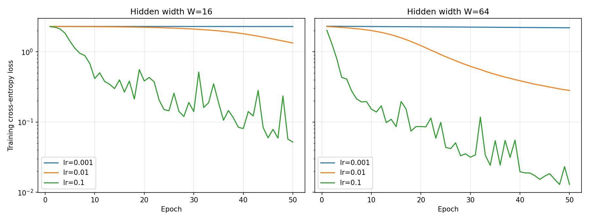

# Lab 2: A Neural Network from Scratch

## 1. Goal

Implement a neural network from scratch using NumPy, verify gradients, train the model, and measure forward and backward pass times.

## 2. Method

The `load_digits` dataset was scaled by dividing pixel values by 16. Labels were one-hot encoded, and the data was split into training and test sets (70/30) using `random_state=42`.

The network has two hidden ReLU layers and a softmax output layer. Hidden widths W = 16 and W = 64 were tested. The notation N(0, 0.01) was interpreted as variance 0.01, giving a standard deviation of 0.1.

## 3. Results

### Parameter counts

| W | W1 | W2 | W3 | Total |
|---:|---|---|---|---:|
| 16 | (64,16) | (16,16) | (16,10) | 1482 |
| 64 | (64,64) | (64,64) | (64,10) | 8970 |

### Forward pass and loss

Both network widths produced output shape (32,10). The maximum row-sum error was 2.22e-16. Initial losses were 2.2988 (W=16) and 2.3158 (W=64), close to ln(10) = 2.3026.

### Backpropagation and gradient check

The output gradient was calculated as `dz3 = (probs - Y) / N`. Gradients were propagated backward through the layers using the chain rule. The ReLU derivative is 1 for positive inputs and 0 otherwise.

The numerical gradient check passed **10/10 weights**, with maximum relative error 5.99e-07. One weight had a very small gradient (5.9e-6), making its relative error more sensitive to numerical noise, but it remained within the required tolerance.

| Parameter | Analytic gradient | Numerical gradient | Relative error | Result |
|---|---:|---:|---:|---|
| W1 (43, 9) | -1.477230e-03 | -1.477230e-03 | 5.71e-09 | OK |
| W1 (58, 3) | -1.349915e-03 | -1.349915e-03 | 6.73e-09 | OK |
| W1 (22, 12) | 5.093874e-04 | 5.093874e-04 | 5.23e-09 | OK |
| W1 (50, 13) | 1.335881e-03 | 1.335881e-03 | 2.97e-09 | OK |
| W3 (14, 0) | 1.088817e-03 | 1.088817e-03 | 1.76e-09 | OK |
| W1 (52, 12) | -5.337228e-03 | -5.337228e-03 | 1.94e-09 | OK |
| W1 (26, 11) | 5.875574e-06 | 5.875567e-06 | 5.99e-07 | OK |
| W3 (11, 2) | 4.663118e-03 | 4.663118e-03 | 1.89e-09 | OK |
| W3 (12, 2) | 3.137707e-03 | 3.137707e-03 | 1.71e-09 | OK |
| W1 (10, 0) | -2.649670e-03 | -2.649670e-03 | 2.65e-09 | OK |

Passed: 10/10 (need >= 9) -> PASS

### Training results

| W | Learning rate | Final loss | Test accuracy |
|---:|---:|---:|---:|
| 16 | 0.001 | 2.2918 | 0.1315 |
| 16 | 0.01 | 1.3362 | 0.5648 |
| 16 | 0.1 | 0.0518 | 0.9407 |
| 64 | 0.001 | 2.1972 | 0.3741 |
| 64 | 0.01 | 0.2824 | 0.9148 |
| 64 | 0.1 | 0.0130 | 0.9630 |

### Timing

Batch size: 32; median of 100 runs.

| W | Forward (µs) | Backward (µs) | B/F |
|---:|---:|---:|---:|
| 16 | 42.2 | 43.4 | 1.03 |
| 64 | 88.6 | 111.4 | 1.26 |

## 4. Conclusions

**Training:** The best result was W=64 with learning rate 0.1, achieving loss 0.0130 and test accuracy 96.30%. A learning rate of 0.001 resulted in slow learning. For W=16 and learning rate 0.1, the loss fluctuated between epochs because of noisy mini-batch updates.

**Gradient check:** Numerical gradient checking compares analytical gradients with finite-difference estimates. It helps detect errors in backpropagation before training. All 10 checks passed.

**Timing:** The forward pass uses three matrix multiplications, while backward propagation uses five. For W=16, their times were similar because of NumPy overhead. For W=64, backward propagation took relatively longer, increasing the B/F ratio from 1.03 to 1.26.