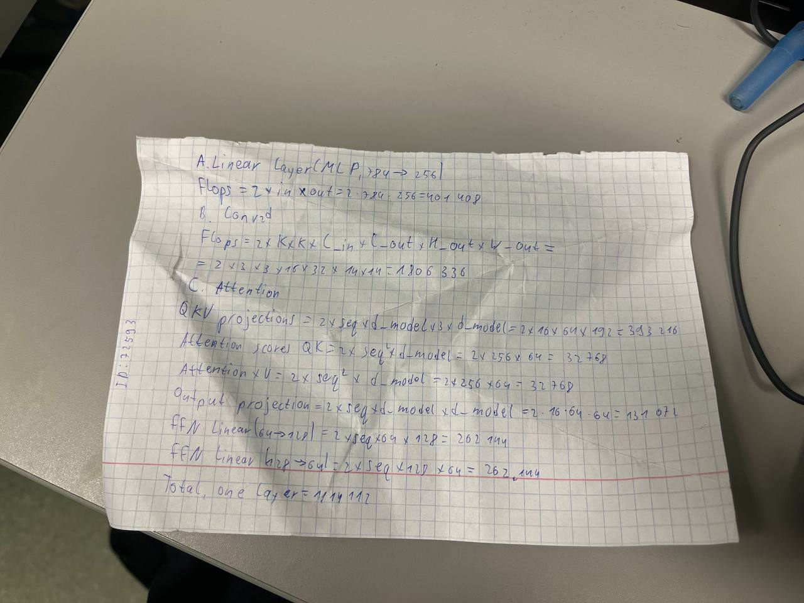
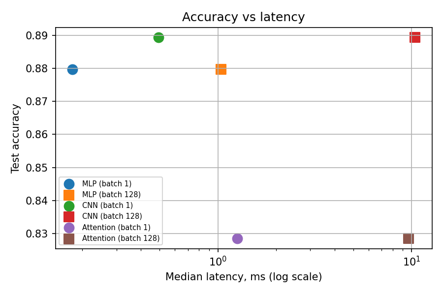
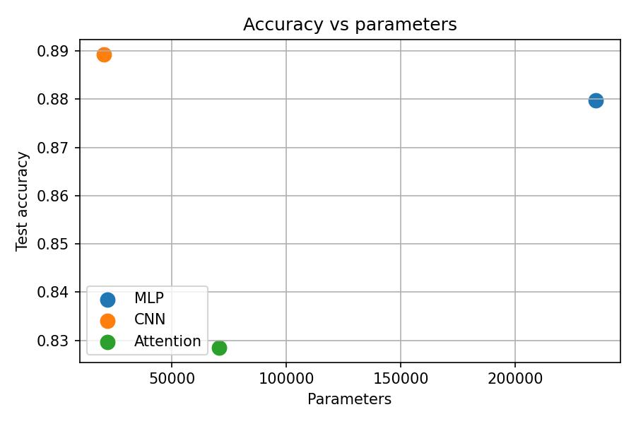

Lab 3 — Architectures and Their Costs
1. Goal
The goal was to compare three neural networks by their size, FLOPs, speed, and test accuracy.

2. Setup
I splitted train from 60k into 55k train and 5k validation images,also used official 10k test images and batch size 128. All models were trained for 5 epochs using Adam with a learning rate of 0.001. The experiments ran on CPU.

3. Models
- MLP: three fully connected layers.
- CNN: two convolutional layers and one fully connected layer.
- Attention: image patches, two Transformer encoder layers, and a classification layer.

4. Parameters and FLOPs
| Model | Parameters | Hand-calculated FLOPs | THOP FLOPs |
|---|---:|---:|---:|
| MLP | 235,146 | 469,504 | 469,504 |
| CNN | 20,490 | 2,063,488 | 2,063,488 |
| Attention | 70,794 | 2,329,856 | 101,632 |

The hand calculations and THOP results match for the MLP and CNN. For Attention, THOP reports a much smaller value, likely because it does not count all operations inside the Transformer layers.

The model sizes do not all fall within the 100,000–150,000 parameter range mentioned in the task. I kept the architectures specified in the instructions.

5. Inference Time
| Model | Batch 1 (ms) | Batch 128 (ms) |
|---|---:|---:|
| MLP | 0.178 | 1.040 |
| CNN | 0.494 | 10.391 |
| Attention | 1.259 | 9.633 |

The MLP was fastest for one image. The Attention model was slowest for one image.

6. Test Accuracy
| Model | Test accuracy |
|---|---:|
| MLP | 87.97% |
| CNN | 88.93% |
| Attention | 82.85% |

The CNN had the highest accuracy. The MLP was close and had the lowest latency for one image. The Attention model had the lowest accuracy in these experiments.

7. Plots and Hand Calculations
The hand calculations for the representative layers are included in the results folder.

8. Conclusion
The CNN gave the best test accuracy, but it was slower for a batch of 128 images. The MLP was the fastest for a single image and also achieved good accuracy. The Attention model had more computation and lower accuracy in this experiment. The results show that model size alone does not tell us how fast a model will run.